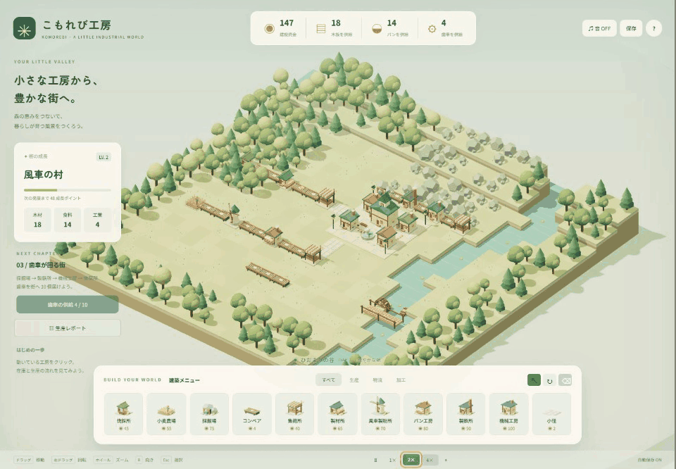

# こもれび工房 / KOMOREBI

森と川に囲まれた高原に、小さなものづくりの街を育てるブラウザ向け3D工場ゲームです。木組みの工房、風車、麦畑、テラコッタの屋根、動く荷物を、柔らかな朝の光で描いたジオラマにしました。

**ブラウザで遊ぶ：[こもれび工房 — GitHub Pages](https://onego15.github.io/factorytown-gpt/)**

`main` へのpush時にGitHub Actionsでテスト・ビルドを実行し、`dist/` をGitHub Pagesへ公開します。公開版とローカル版の保存データはURLが異なるため別々です。



**GIFは本物のブラウザ実行画面です。** Playwrightで実際に建設した街の保存データを再開し、設備の選択、カメラのズームと回転を操作して録画しました。[元の実録画動画](docs/demo.webm)から160フレームを抽出し、約20秒のGIFにしています。生成画像や架空のプレイ映像は使っていません。録画は `scripts/record-video.mjs`、GIF化は `scripts/video-to-gif.py` です。連続スクリーンショットから作る別方式も `scripts/record-demo.mjs` と `scripts/make-gif.py` に残しています。

## 遊び方

最初から木材とパンの2本のラインが稼働します。建物をクリックして在庫を観察し、工房を増設・強化して街への供給を増やしましょう。

| 生産ライン | 街での価値 |
| --- | --- |
| 伐採所 → 原木 → 製材所 → 木板 → 集荷所 | 4コイン・1成長ポイント |
| 小麦農場 → 小麦 → 風車製粉所 → 小麦粉 → パン工房 → パン → 集荷所 | 7コイン・2成長ポイント |
| 採掘場 → 鉄鉱石 → 製鉄所 → 鉄材 → 機械工房 → 歯車 → 集荷所 | 12コイン・4成長ポイント |

- 各設備の間をコンベアで接続します。コンベア・生産設備は設定した方向の隣接マスへ搬出します。受け入れは対応する品種に限ります。
- 伐採所は西側の森林、採掘場は北側の岩場に建設します。水面や街の広場には建設できません。
- コンベア上の品物は実在する在庫です。到着時に搬送先の在庫へ移り、加工で消費されます。集荷所へ届いた完成品は街で消費されます。
- 搬入在庫は5個、搬出在庫は3個。搬送先が満杯・不在・不適合なら詰まり、生産が止まります。コンベア1本に載るのは1個です。
- 木板とパンを各5個届け、120コインを使うと「鉄の時代」を研究できます。
- 建物は3レベルまで強化できます。生産速度は基準の1倍 → 1.6倍 → 2.2倍。強化費用は40、80コインです。
- 街は成長ポイント30、110、260で発展し、広場の家や住民が増えます。歯車10個の供給がひとつの到達目標です。以後も自由に増築できます。
- 小径は景観用です。品物の物流にはコンベアを使ってください。

## 操作方法

| 操作 | 入力 |
| --- | --- |
| 建築 | 下部メニューで建物を選び、地面をクリック |
| 建物の選択・在庫・アップグレード | 選択モードで建物をクリック |
| 地図移動 | 左ドラッグ |
| カメラ回転 | 右ドラッグ |
| ズーム | ホイール |
| 搬出方向の変更 | R または ↻。選択中は既存設備、建築中は配置予定設備を回転 |
| コンベアの連続建設 | コンベアを選び Shift + ドラッグ |
| 建築終了・選択へ戻る | Esc |
| 撤去モード | X または ⌫。建設費の半分を返却。在庫は失われる |
| 一時停止 | Space または Ⅱ |
| 倍速 | 1× / 2× / 4× |
| カメラ初期位置 | H または ⌖ |
| 保存 | 保存ボタン、Ctrl / Cmd + S。20秒ごとにも自動保存 |
| 説明・新しい街 | 右上の ? |
| 環境音 | 右上の ♫ 音 OFF / ON。初期状態は消音 |

保存先はブラウザの `localStorage`（キー `komorebi-save-v1`）です。建物、向き、レベル、搬送中の品、加工途中の進捗、在庫、研究、供給数、資金、時間、倍速設定を保存します。**同じブラウザ・同じURLとポート**で再開してください。クラウド保存や閉じている間の進行はありません。

## 起動方法

Node.js 22.12以降を推奨します。

```sh
npm install
npm run dev
```

表示されたローカルURL、通常 **http://127.0.0.1:5173/** をブラウザで開きます。Windowsでは依存関係をインストールした後、`start.bat` のダブルクリックでも起動できます。

```sh
npm run build       # 配布用の dist/ を生成
npm test            # 生産シミュレーションの10項目
```

`dist/` は静的Webサーバーで配信できます。HTMLのファイル直開きはES Modulesを使うため非対応です。Google Fontsが使えない場合はシステムフォントへフォールバックします。ゲーム本体のコード・3Dモデル・音はローカルで完結しています。

ブラウザ操作検証と録画の再現（Chromeがインストールされた環境、開発サーバー起動中）：

```sh
node scripts/browser-test.mjs
node scripts/layout-check.mjs
node scripts/record-demo.mjs
python -m pip install Pillow
python scripts/make-gif.py
```

## 使用技術・アート制作

- JavaScript ES Modules / Three.js 0.180 / WebGL
- Vite 7（正確な依存バージョンは `package-lock.json`）
- CSSによる日本語UI、ローカル保存、Web Audio APIによる環境和音と操作音
- Playwright / Chromeによる実ブラウザ操作、Node.js標準テストランナー、Pillowによる実録画のGIF化
- 3Dアセットはすべてコードで制作。木組み、屋根、窓、煙突、製粉用の帆、麦、材木、製品、看板、広場、街灯、噴水、住民を組み合わせた、意図的なローポリ・ジオラマ様式です。仮素材・外部ゲームからの流用アセットはありません。
- 建築メニューのサムネイルはゲーム内の3Dモデルを実際にレンダリングしたものです。

## AIサービス・モデル

- 使用AIサービス：**OpenAI Codex（デスクトップアプリ）**。
- システム説明上のモデル系統：**GPT-6系**。
- **正確なモデル識別子は、この実行環境から確認できません。** 非公開のモデル名や推論設定を推測で記載していません。この点は依頼のうち確認できなかった項目です。
- 画像生成AI・音楽生成AI・別AIサービスは使用していません。コード、文書、モデル形状、音響処理をCodexで制作しました。

## 制作記録と検証

- 制作開始：**2026-10-21 09:30:37 JST**（時計ツールで確認）。
- 制作・最終検証終了：**2026-10-21 09:54:57 JST**。経過 **24分20秒**。詳しい工程は [docs/production-log.md](docs/production-log.md) に記載。
- 生産シミュレーションの自動テスト：**10項目合格**。
- 実ブラウザ検証：**18項目合格**。詳細と実行時刻は [docs/browser-test-results.json](docs/browser-test-results.json)。
- 実ブラウザで建設した鉄ラインから歯車の供給、資金増減、回転・撤去・研究・強化・保存再開を確認しました。
- スクリーンショット確認後、見出しの改行、720px高の画面でのパネル重なり、復元した倍速表示、配置グリッドを改善しました。追加の小画面テストで、進行パネル・レポートボタン・スクロールできる詳細パネルの重なりがないことと、強化操作を確認しました。
- 描画負荷を減らすため、森・地形・建物・広場の静的メッシュを材質ごとにまとめました。最適化中に見つかった形状インデックス不一致を修正し、ブラウザ検証を再実行しています。
- ビルド時の大きなバンドルに関する警告はThree.jsを含むためです。失敗ではありません。

### 検証の範囲・限界

Windows版Chromeのヘッドレス実行で1440×1000と1280×720を検証し、実画像を確認しました。性能計測はこの環境の参考値です。Safari・Firefox・実スマートフォン・低性能端末は未検証です。タッチ用カメラ操作はありますが、PCのマウス操作を主対象にしています。音の生成処理は実装しましたが、実スピーカーでの聴感確認はしていません。大規模工場の長時間負荷検証とクラウドセーブは行っていません。

2026-10-21にGitHub Pagesへ公開しました。公開URLをChromeで開き、HTTP 200、3D起動、木板3個・パン1個の供給、資金420→439の増加、未捕捉例外0を確認済みです。[公開ワークフローの成功記録](https://github.com/onego15/factorytown-gpt/actions/runs/39587432041)。

## 制作プロンプト全文

以下は依頼者から与えられた制作指示の全文です。

```text
Factory Townに着想を得た、立体的な街づくりと工場自動化を組み合わせたゲームを制作してください。

ブラウザで快適に遊べる、商業インディーゲームのような完成度を目指してください。

**最も重視するのは、美しく統一感のある立体的な世界、自動化した生産ラインを眺める楽しさ、分かりやすく快適な建築UI、街が発展していく達成感です。**

### ゲーム内容
- 立体的な地形の上に街や工場を建設できる
- 森林、鉱山、農地などから資源を生産する
- 原材料を加工して新しい製品を作る
- ベルトコンベアや運搬設備で資源を輸送する
- 生産した製品を街に供給して発展させる
- 研究や建物のアップグレードで新しい生産設備を解放する
- 生産量や資源の流れを確認しながら効率化を楽しめる

### 立体表現
- 高低差を感じられる地形
- カメラの回転・ズーム・移動
- 建物、道路、物流設備が立体的に組み合わさる景観
- 輸送中の資源が実際に動くアニメーション
- 街の発展に合わせて景色が変化する演出

### UI/UX
- 建物の配置・撤去・選択が直感的に行える
- 資源の入力・出力や生産速度を分かりやすく表示
- 建設できない場所には明確なフィードバックを出す
- 生産ラインの接続や物流の流れが理解しやすい
- 複雑な情報を詰め込みすぎず、整理された美しいUIを目指す

### 制作方針
3D、HD-2D、アイソメトリックなど、表現方法は自由です。世界観やアートスタイルも任せます。

生産・輸送・消費が実際につながるシミュレーションを実装してください。

資源が画面上で動くだけの演出ではなく、搬送先の在庫や生産処理に正しく反映されるようにしてください。

大規模な生産ツリーより、小規模でも複数の生産ラインを構築して効率化できる完成度を優先してください。

技術選定やアセット制作方法は自由です。

制作途中の確認は不要です。建設、物流の接続、生産、在庫の増減、アップグレード、保存と再開を可能な限り実際にテストし、問題があれば改善してください。

### 品質改善・自律制作（最重要）

ゲームが動作するようになった段階では、まだ完成ではありません。

基本機能の実装後、グラフィック、アニメーション、演出、UI/UX、ゲームバランスを改善する工程を必ず設けてください。

特に以下を徹底してください。

- 機能が実装されたことだけを理由に完成と判断しない
- 実際にゲームを起動してスクリーンショットを確認し、見栄えの悪い部分を改善する
- プリミティブな図形や仮素材を使った場合は、最終的に作品の世界観に合う素材へ置き換える。ただし意図的なアートスタイルとして成立している場合は除く
- 背景、キャラクター、建物、UI、アニメーション、音響まで一貫したアートディレクションを行う
- 可能な限り実際にゲームをプレイし、操作性、ゲーム進行、難易度、演出を検証する
- 初回の実装で満足せず、発見した問題を修正し、再確認するサイクルを繰り返す
- 制作時間の短縮よりも最終的なゲーム品質を優先する
- コンテンツ量を増やすより、少ない要素を高品質に仕上げる
- 利用可能な作業時間・ツール・実行予算の範囲内で、可能な限り完成度を高める

**目標は動作する技術デモではなく、人が遊んで楽しいと感じる、視覚的にも完成されたゲームです。**

私への途中確認は不要です。制作、動作確認、改善まで自律的に実施してください。検証できなかった項目は完了したと装わず、正直に報告してください。

### README・制作記録

README.mdにはゲーム紹介、実際のプレイ映像から作ったGIF（docs/demo.gif）、操作方法、起動方法、使用技術、AIサービス名、正確なモデル名、制作プロンプト全文を記載してください。

加えて、制作開始・終了日時、経過時間、実施したテスト、グラフィックやUIの改善内容も、確認できる範囲で記録してください。

GIFは実際に動作するゲームの録画を使用し、架空のプレイ映像で代用しないでください。録画できない場合はその旨を明記してください。
```
